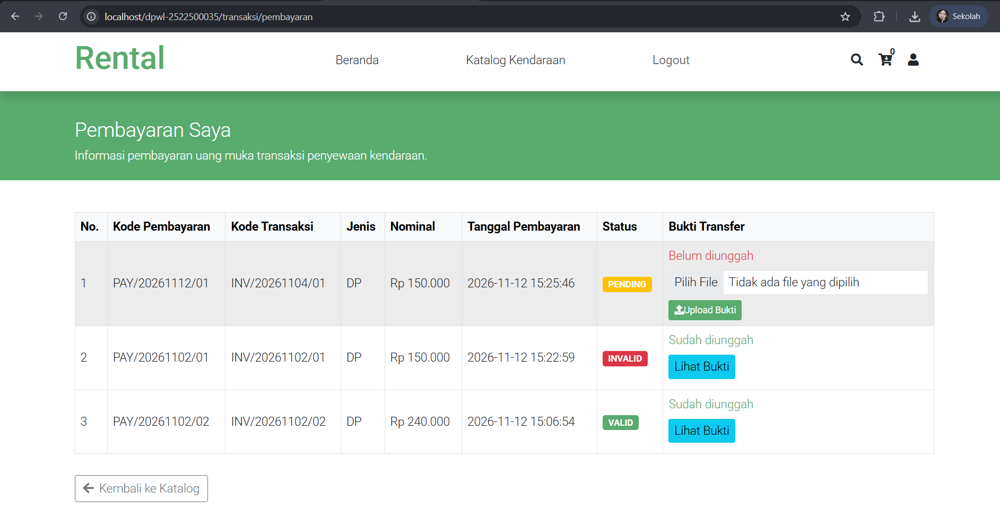
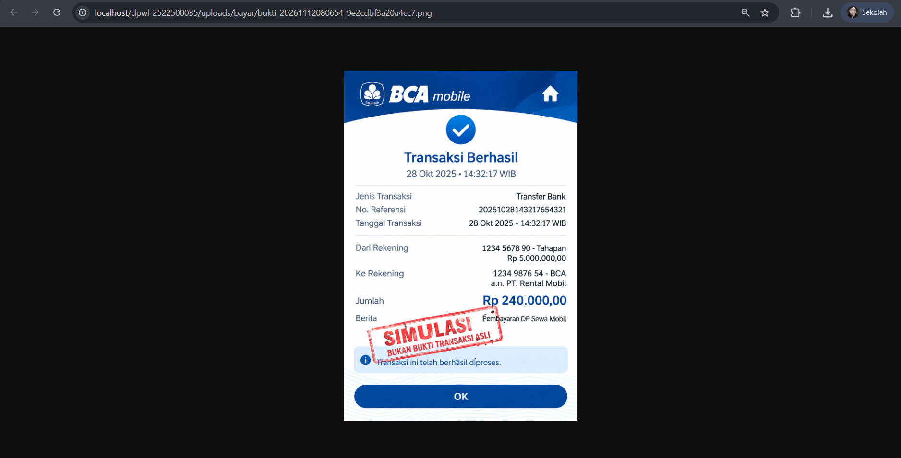
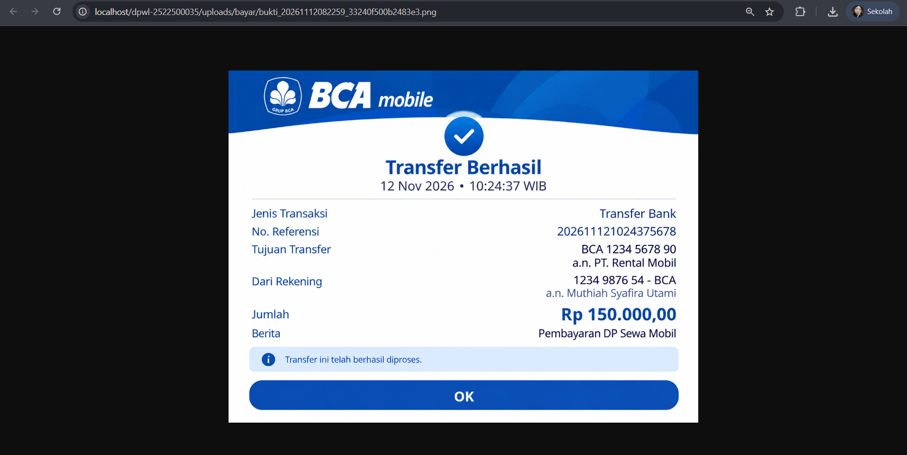
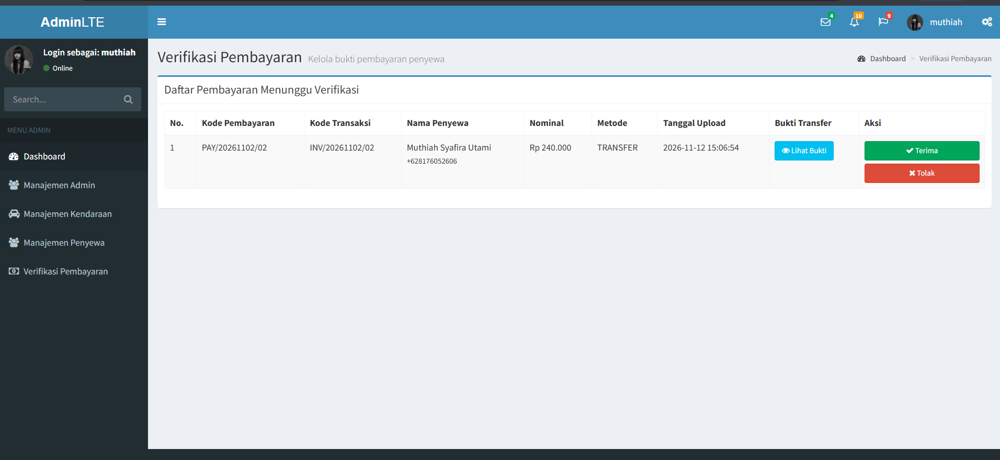
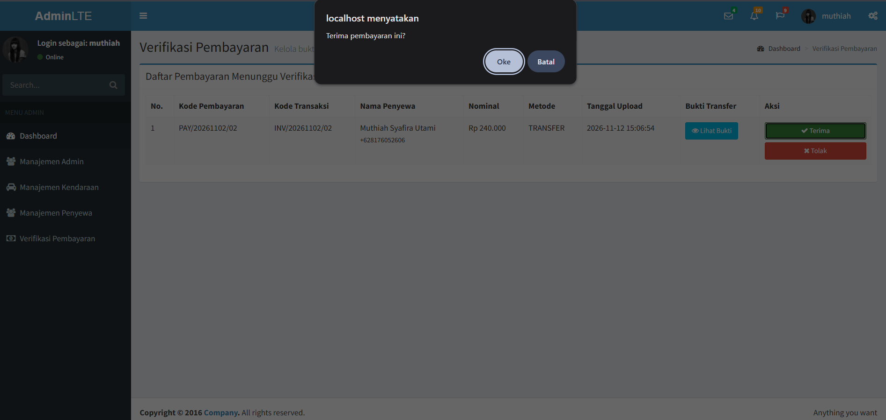

# pertemuan-09 - Pembayaran Awal dan Verifikasi Pembayaran

## 1. Deskripsi
Pengembangan fitur pembayaran awal (DP) dan verifikasi pembayaran pada aplikasi penyewaan kendaraan. Fitur ini memungkinkan penyewa mengunggah bukti pembayaran dan admin melakukan verifikasi terhadap pembayaran tersebut.

## 2. Fitur yang Dikembangkan

### A. Halaman Pembayaran Penyewa
- Menampilkan daftar pembayaran milik penyewa yang sedang login.
- Menampilkan kode pembayaran, kode transaksi, nominal, metode pembayaran, dan status pembayaran.
- Menyediakan fitur upload bukti pembayaran.
- Mendukung file JPG, JPEG, PNG, WEBP, dan PDF.
- Membatasi ukuran file maksimal 5 MB.
- Menyimpan bukti pembayaran ke folder `uploads/bayar/`.
- Mengubah tanggal upload dan menyimpan nama file bukti pembayaran.
- Status pembayaran tetap `pending` sampai diverifikasi admin.

### B. Halaman Verifikasi Pembayaran Admin
- Menampilkan daftar pembayaran berstatus `pending` yang sudah memiliki bukti transfer.
- Menampilkan informasi penyewa dan transaksi.
- Menampilkan bukti pembayaran.
- Menyediakan tindakan menerima atau menolak pembayaran.

### C. Proses Verifikasi
- Jika diterima, status pembayaran berubah menjadi `valid` dan status transaksi menjadi `disetujui`.
- Jika ditolak, status pembayaran berubah menjadi `invalid` dan status transaksi menjadi `ditolak`.
- Menyimpan tanggal dan waktu verifikasi.
- Menggunakan transaksi database untuk menjaga konsistensi perubahan data.
- Pembayaran yang sudah diverifikasi tidak dapat diverifikasi kembali.

### D. Keamanan
- Penyewa hanya dapat mengakses pembayaran miliknya sendiri.
- Halaman verifikasi hanya dapat diakses admin yang sudah login.
- Pengguna tanpa login tidak dapat mengakses halaman admin.
- Proses verifikasi hanya menerima request POST.

## 3. Database

Tabel yang digunakan:
- `t_bayar`
- `t_sewa`
- `t_penyewa`

Kolom pembayaran yang digunakan antara lain:
- `kode_bayar`
- `tgl_wkt_byr`
- `ft_byr`
- `mtode_byr`
- `jns_byr`
- `nominal`
- `sttus_byr`
- `tgl_wkt_ver`
- `kode_sewa`

## 4. Hasil Pengujian

| No. | Pengujian | Hasil |
|---|---|---|
| 1 | Upload bukti pembayaran | Berhasil |
| 2 | Pembayaran tanpa bukti tidak ditampilkan | Berhasil |
| 3 | Admin menerima pembayaran | Berhasil |
| 4 | Admin menolak pembayaran | Berhasil |
| 5 | Penyewa tidak dapat mengakses halaman admin | Berhasil |
| 6 | Pengguna tanpa login harus login terlebih dahulu | Berhasil |
| 7 | Pembayaran yang sudah diverifikasi tidak muncul kembali | Berhasil |

Catatan: Pengujian upload tanpa memilih file dan file melebihi 5 MB perlu dilengkapi.

## 5. Lokasi Halaman

Halaman penyewa:
`/transaksi/pembayaran`

Halaman admin:
`/admin/verifikasi-pembayaran`

## 6. Penyimpanan Bukti Pembayaran

Folder penyimpanan:
`uploads/bayar/`

Bukti pembayaran disimpan menggunakan nama file yang dibuat secara acak untuk menghindari benturan nama file.

## 7. Kesimpulan

Fitur pembayaran awal dan verifikasi pembayaran telah berhasil dikembangkan dan diuji pada proses upload bukti pembayaran, penerimaan pembayaran, penolakan pembayaran, serta pembatasan hak akses admin dan penyewa.

## Dokumentasi Screenshot

### 1. Halaman Pembayaran 

### 2. Bukti Pembayaran Valid

### 3. Bukti Pembayaran Invalid

### 4. Daftar Pembayaran Menunggu Verifikasi Admin

### 5. Daftar Pembayaran Diterima Admin

### 6. Daftar Pembayaran Setelah Diterima Admin

