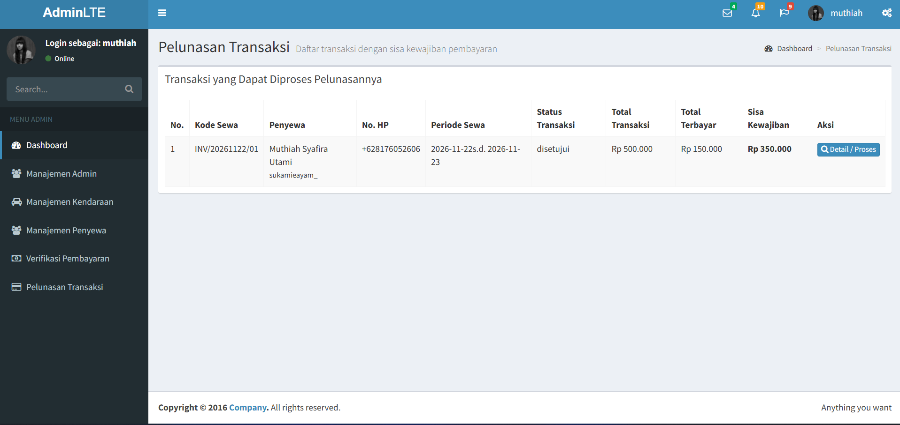
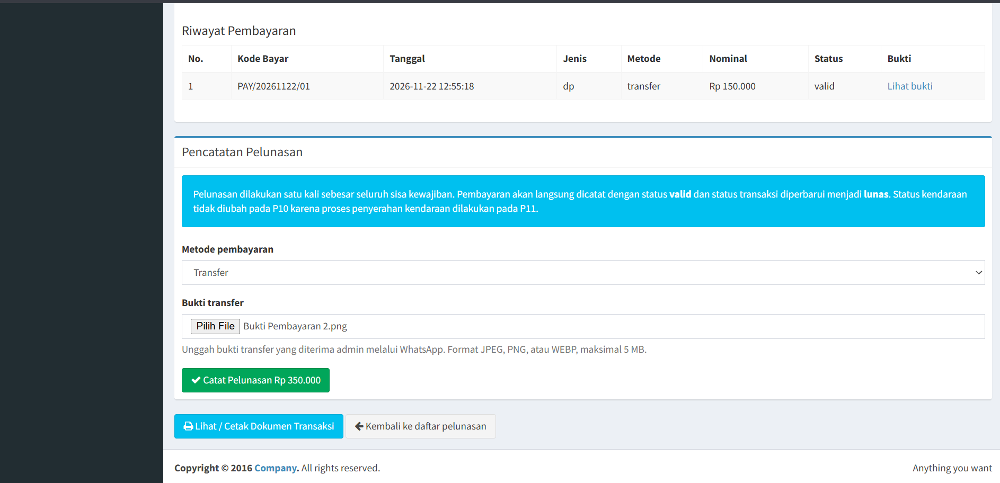
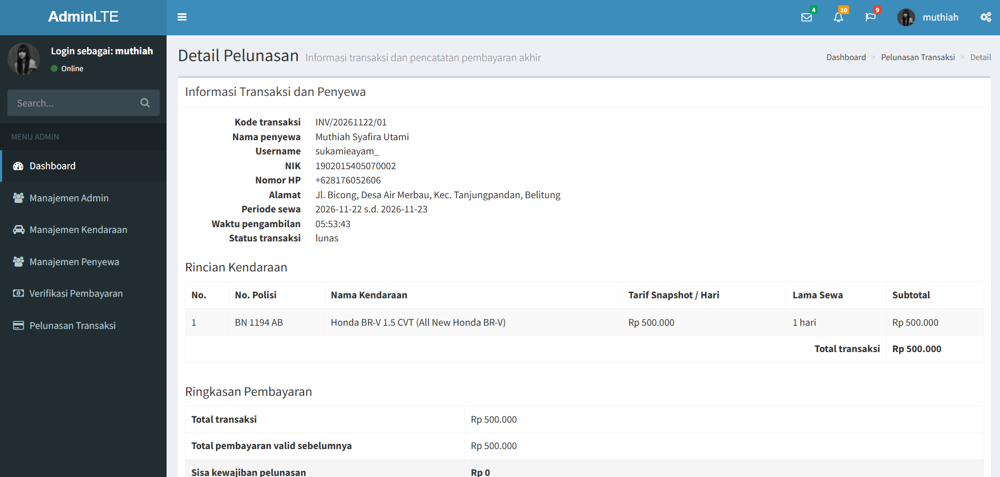
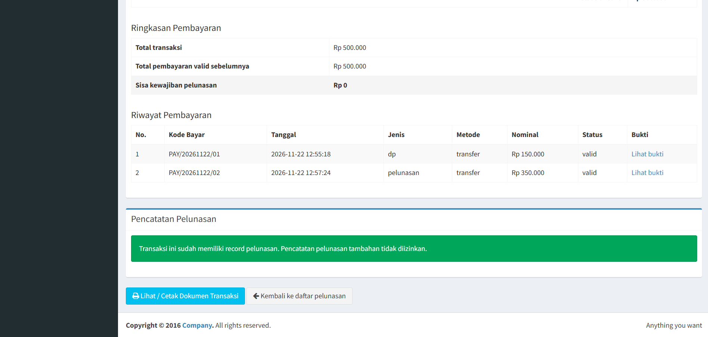
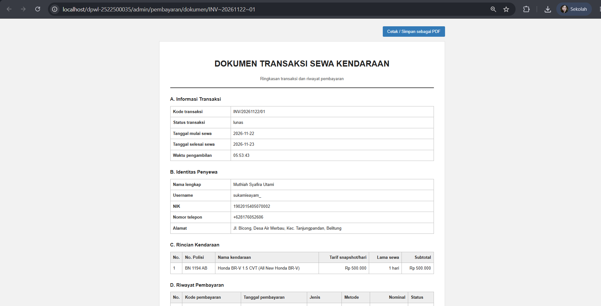
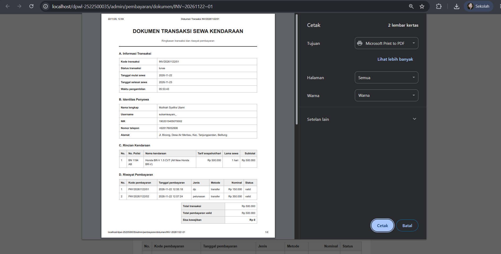

# pertemuan-10

## 1. Perubahan Database 

Pada tabel `t_sewa`, kolom `status_sewa` mengalami penambahan nilai ENUM `lunas`.

Nilai ENUM setelah perubahan:

- diajukan
- disetujui
- ditolak
- aktif
- selesai
- batal
- keranjang
- lunas

Perubahan dilakukan melalui phpMyAdmin pada database proyek.

## 2. Penambahan Method pada Pembayaran_model

File: application/models/Pembayaran_model.php

### 2.1 getDaftarPelunasan()

Digunakan untuk mengambil daftar transaksi penyewaan yang memiliki kewajiban pelunasan, termasuk data penyewa, total biaya, total pembayaran valid, dan sisa pembayaran.

### 2.2 getDetailPelunasan (string $kodeSewa)

Digunakan untuk mengambil detail transaksi penyewaan berdasarkan kode sewa, meliputi informasi penyewa, kendaraan, periode sewa, total biaya, riwayat pembayaran, dan sisa pelunasan.

### 2.3 buatKodeBayarPelunasan (string $tanggalKode)
 
Digunakan untuk membuat kode pembayaran pelunasan secara otomatis dengan format PAY/YYYYMMDD/NN, menggunakan nomor urut berdasarkan tanggal.

### 2.4 simpanPelunasan (string $kodeSewa, string $metodeBayar, string $namaFileBukti = null)

Digunakan untuk memproses dan menyimpan pembayaran pelunasan ke database. Method ini melakukan validasi transaksi, metode pembayaran, nominal pelunasan, dan mencegah pembayaran dilakukan lebih dari satu kali.

Setelah pelunasan berhasil disimpan, status transaksi penyewaan diperbarui menjadi lunas.

## 3. Penambahan Method pada Pembayaran_controller

File: application/controllers/Pembayaran_controller.php

### 3.1 pelunasanIndex()

Digunakan untuk menampilkan halaman daftar transaksi penyewaan yang memiliki kewajiban pelunasan. Method ini hanya dapat diakses oleh admin dan mengambil data melalui method getDaftarPelunasan() pada Pembayaran_model.

### 3.2 pelunasanDetail (string $kodeSewa)

Digunakan untuk menampilkan detail transaksi penyewaan berdasarkan kode sewa. Informasi yang ditampilkan meliputi data penyewa, kendaraan, periode sewa, riwayat pembayaran, dan sisa tagihan yang harus dilunasi.

### 3.3 prosesPelunasan (string $kodeSewa)

Digunakan untuk memproses pembayaran pelunasan oleh admin. Method ini melakukan validasi metode pembayaran, memproses unggahan bukti pembayaran apabila menggunakan transfer, kemudian menyimpan data pelunasan melalui simpanPelunasan() pada Pembayaran_model.

### 3.4 dokumenTransaksi()

Digunakan untuk menangani akses dokumen transaksi sebagai bukti administrasi penyewaan.

### 3.5 Integrasi Helper dan Upload Bukti Pelunasan

Ditambahkan pemanggilan `auth_helper.php` dan `flash_helper.php` pada constructor `Pembayaran_controller` untuk mendukung pemeriksaan hak akses admin dan pengelolaan pesan notifikasi.

Selain itu, ditambahkan method bantuan:

- `simpanFileBukti()` digunakan untuk mengunggah dan memvalidasi bukti transfer pelunasan.
- `hapusBuktiBaru()` digunakan untuk menghapus file bukti yang sudah diunggah apabila proses penyimpanan pelunasan ke database gagal.

## 4. Penambahan Route

Pada file konfigurasi route, dilakukan penambahan empat route untuk menghubungkan fitur pelunasan dengan method pada `Pembayaran_controller`.

### 4.1 Route Daftar Pelunasan

```php
$route['admin/pembayaran/pelunasan'] = 'Pembayaran_controller/pelunasanIndex';
```

Digunakan untuk mengakses halaman daftar transaksi yang memiliki kewajiban pelunasan.

### 4.2 Route Detail Pelunasan

```php
$route['admin/pembayaran/pelunasan/(:any)'] = 'Pembayaran_controller/pelunasanDetail/$1';
```

Digunakan untuk menampilkan detail pelunasan berdasarkan kode sewa.

### 4.3 Route Proses Pelunasan

```php
$route['admin/pembayaran/pelunasan/proses/(:any)'] = 'Pembayaran_controller/prosesPelunasan/$1';
```

Digunakan untuk memproses pembayaran pelunasan berdasarkan kode sewa melalui metode POST.

### 4.4 Route Dokumen Transaksi

```php
$route['admin/pembayaran/dokumen/(:any)'] = 'Pembayaran_controller/dokumenTransaksi/$1';
```

Digunakan untuk mengakses dokumen transaksi berdasarkan kode sewa.

## 5. Integrasi Menu Pelunasan pada Sidebar Admin

Dilakukan penambahan menu **Pelunasan** pada sidebar admin agar admin dapat mengakses fitur pengelolaan pelunasan secara langsung.

Menu Pelunasan diarahkan ke route:

```php
site_url('admin/pembayaran/pelunasan')
```

Melalui menu tersebut, admin dapat melihat daftar transaksi yang memiliki sisa kewajiban pembayaran, membuka detail transaksi, memproses pelunasan, dan mengakses dokumen transaksi.

## 6. Penambahan View Daftar dan Detail Pelunasan

Ditambahkan dua file view pada folder `application/views/admin/` untuk mendukung tampilan fitur pelunasan transaksi.

### 6.1 View Daftar Pelunasan (`pelunasan.php`)

Digunakan untuk menampilkan daftar transaksi penyewaan yang masih memiliki sisa kewajiban pembayaran.

Informasi yang ditampilkan meliputi:

- Kode sewa.
- Nama penyewa.
- Nomor HP.
- Periode sewa.
- Status transaksi.
- Total transaksi.
- Total terbayar.
- Sisa kewajiban.
- Aksi untuk melihat detail pelunasan.

Apabila tidak terdapat transaksi yang memiliki sisa kewajiban, sistem akan menampilkan pesan bahwa tidak ada transaksi yang dapat diproses pelunasannya.

### 6.2 View Detail Pelunasan (`pelunasan_detail.php`)

Digunakan untuk menampilkan informasi detail transaksi penyewaan dan riwayat pembayaran berdasarkan kode sewa.

Informasi yang ditampilkan meliputi:

- Data penyewa.
- Kode dan periode sewa.
- Informasi kendaraan yang disewa.
- Total transaksi.
- Total pembayaran yang telah dilakukan.
- Sisa kewajiban pembayaran.
- Riwayat pembayaran.

Selain itu, halaman ini menyediakan form untuk memproses pelunasan apabila transaksi masih memiliki sisa kewajiban dan memenuhi ketentuan pelunasan.

## 7. Dokumentasi

### 1. Halaman Detail Transaksi yang harus dilunasi 


### 2. Halaman Pelunasan Via TF


### 3. Halaman Detail Transaksi Lunas yang berhasil ditampilkan




### 3. Halaman Detail Dokumen Transaksi Sewa Kendaraan


